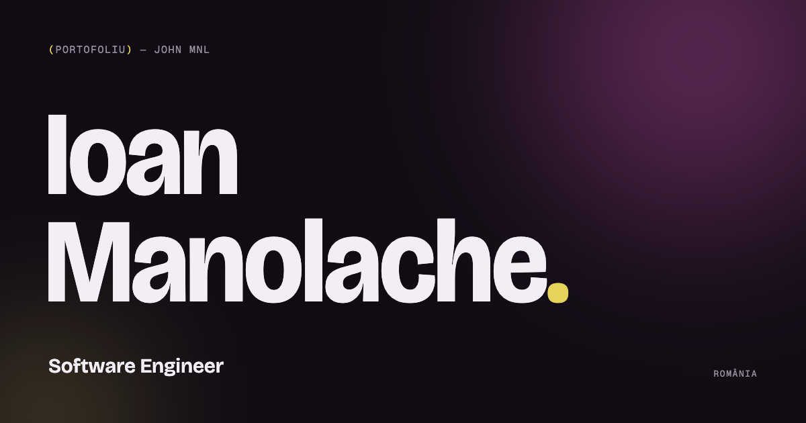

# John Mnl · Portofoliu

Portofoliul personal al lui Ioan Manolache (John Mnl), Software Engineer din România.

**Live:** [manolacheioan.github.io](https://manolacheioan.github.io)



## Ce conține

- **Proiecte:** pagină pentru fiecare proiect, cu capturi de ecran, funcții, tehnologii și link spre codul sursă. Filtre după tip (personal sau demo) și după tehnologie.
- **Despre mine, educație și tehnologii:** tehnologiile sunt interactive. Alegi una și vezi în ce proiecte am folosit-o.
- **Contact:** formular care trimite mesajele prin Formspree.
- **Bilingv:** română (implicit, `/`) și engleză (`/en/`).
- **Temă luminoasă și întunecată**, salvată pentru fiecare vizitator, fără flash la încărcare.
- **Animații** la scroll și tranziții între pagini, care se opresc pentru cei care au setat „reduced motion”.

## Tehnologii

Next.js 16 (App Router, export static) · React 19 · TypeScript · Tailwind CSS 4 · Motion

## Detalii tehnice

- Site complet static: `npm run build` generează HTML, CSS și JS în `/out`.
- Publicare automată pe GitHub Pages prin GitHub Actions la fiecare push pe `main`, cu verificare de lint înainte de build ([`deploy.yml`](.github/workflows/deploy.yml)).
- SEO: metadate și previzualizări pentru fiecare pagină, versiuni de limbă, sitemap și date structurate (JSON-LD).
- Conținutul stă separat de componente, în [`/data`](data): profil, proiecte, educație, tehnologii și textele interfeței în ambele limbi.
- Capturile proiectelor sunt optimizate în WebP, în trei dimensiuni, cu `npm run images`.
- Teste end-to-end cu Playwright, pe telefon și desktop: pagina principală, schimbarea limbii, tema, filtrele de proiecte, linkurile de cod sursă, formularul de contact (fără trimiteri reale) și pagina 404. Plus verificarea automată de accesibilitate cu axe (WCAG 2.2 AA). Rulează la fiecare push, înainte de publicare.
- Lighthouse pe desktop: 98–99 la performanță și 100 la accesibilitate, bune practici și SEO.

## Rulare locală

```bash
npm install
npm run dev     # http://localhost:3000
npm run build   # site-ul static în /out
npm run lint && npm run typecheck
npm run test:e2e   # teste Playwright pe build-ul din /out (rulează întâi npm run build)
```

## Autor

Ioan Manolache · [LinkedIn](https://www.linkedin.com/in/ioan-manolache-469a2a31b/) · [GitHub](https://github.com/ManolacheIoan)
